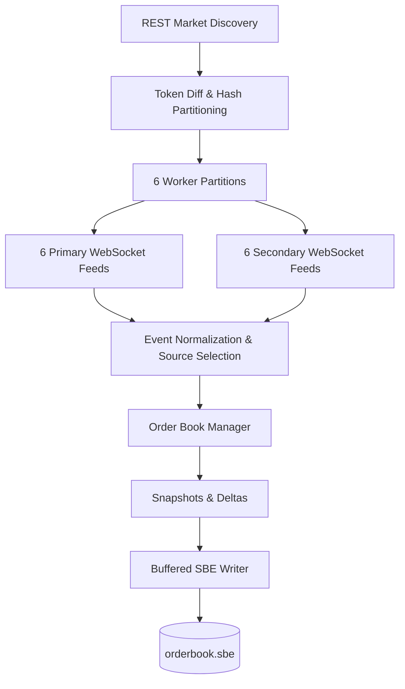

# High-Throughput Level-2 Order Book Collector

A low-latency Polymarket market-data collector featuring redundant WebSocket feeds, automatic failover, normalized order-book processing, and SBE persistence.

> **Base repository:** Built upon [voluntas-io/engineering-challenge-template](https://github.com/voluntas-io/engineering-challenge-template), extended with dual-feed redundancy, automatic failover, dynamic market discovery, and a decoupled collector core.

## Architecture

## Performance

- **Throughput:** Processed 23.7M+ market updates across ~26.9K active tokens.
- **Latency:** 14 ms average, 13 ms p50, and 17 ms p95.
- **Memory footprint:** 212–230 MB RSS during sustained operation.

## Key Features

- Redundant primary and secondary WebSocket feeds with automatic failover.
- Dynamic market discovery and subscription management.
- Normalized, exchange-independent market-data model.
- Separate primary and secondary order books.
- **FIX SBE serialization:** Encodes order-book snapshots and incremental deltas into compact, schema-defined binary messages.
- **Buffered persistence:** Uses aligned 64 MiB disk chunks and buffered writes to efficiently persist market data to `orderbook.sbe`.

## License

MIT